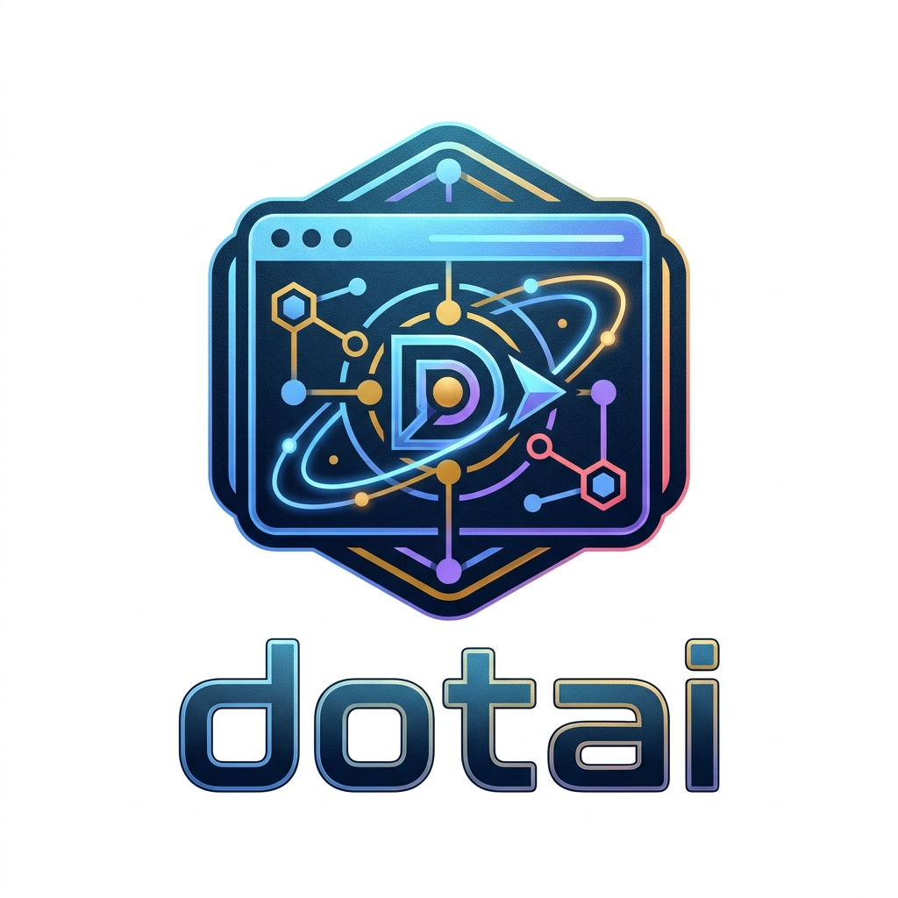

<div align="center">
  

  [](apm.yml)
  [](LICENSE)
  [](#supported-tools)

  **🤖 One repo to rule all your AI tools — rules, skills, agents, and hooks in sync ✨**

</div>

---

## Overview

**The Pain:** Configuring coding rules, skills, and agent personas across Claude, Cursor, and Copilot means scattered files and constant drift.

**The Solution:** `dotai` is a single source of truth. Edit once, run one script, and every AI tool picks up the changes via symlinks — instantly.

**The Result:** Your AI pair programmer behaves consistently everywhere, with zero manual syncing.

## What's Included

| Type | Path | Purpose |
|------|------|---------|
| 📏 **Rules** | `rules/coding.md` | Coding standards — style, error handling, typing, dependencies |
| 🌐 **Global instructions** | `global/` | Agent workflow rules (MRs/PRs), compiled by APM into every tool's global AGENTS.md |
| 🔧 **Skills** | `skills/<category>/<name>/SKILL.md` | Skills authored here |
| 📦 **Dependencies** | `apm.yml` | Upstream skills and public MCP servers, pinned in `apm.lock.yaml` |
| 🤖 **Agents** | `agents/<name>.md` | Named sub-agent personas (architect, reviewer) |
| 🪝 **Hooks** | `hooks/` | Lifecycle hooks: `session_start`, `task_complete` |

## 🚀 Quick Start

```bash
git clone https://github.com/yourusername/dotai
cd dotai
apm install                 # fetch pinned upstream skills + MCP servers
bash scripts/install.sh     # update private skills and publish everything to your tools
```

That's it. All rules and skills are symlinked into every supported tool's config directory.

The installer initializes and updates `skills/internal` to the commit pinned by
dotai before publishing skills. If the private repository is unavailable or local
changes prevent the update, it warns and continues with the available skills.
`install.sh --list` only lists skills and does not update the submodule.

Requires [APM](https://github.com/microsoft/apm). If your network blocks SSH to
GitHub, run `apm config set allow-protocol-fallback true` once so clones fall
back to HTTPS.

### Public MCP servers

`apm.yml` registers GitHub's HTTP MCP and the local [cua-driver](https://github.com/trycua/cua/tree/main/libs/cua-driver)
stdio server (`cua-driver mcp`). `apm install` writes both into `.mcp.json` and
the project Codex config. The `cua-driver` binary and macOS app come from
[dotnix](https://github.com/NoSugarCoffee/dotnix) (`just switch` there); this
repo only lists the server.

### Private MCP servers

Private MCP definitions live in `skills/internal/apm.yml` in the private
`dotai-internal` submodule. After initializing the pinned submodule with
`bash scripts/install.sh`, preview and apply them from the dotai root:

```bash
bash scripts/install.sh --sync-mcp --dry-run
bash scripts/install.sh --sync-mcp
# Optionally select a tool:
bash scripts/install.sh --sync-mcp --target claude
```

This mode delegates to the private sync script and requires Ruby and APM. It
updates user-level APM and tool configuration without publishing rules or skills.
The dry run does not initialize or update the submodule. Existing managed tool
targets are retained; selecting a tool adds or updates that target. Servers using
remote HTTP skip Codex. Native connection conflicts are reported and preserved.

Change private definitions through a PR in `dotai-internal`, then update the
submodule pointer here to the approved commit. Ordinary `install.sh` runs only
publish rules and skills; private MCP sync is explicit. Project `apm install`
continues to manage the public MCPs. Keep private server names, URLs, headers,
and tokens out of this repository's `apm.yml`, `.mcp.json`, and lockfile.

### Agent credentials

Agents read logins without prompting you (see "Credentials" in `global/`). Set up
one or both stores once per machine. The keys go in `~/.zshrc-local`, which is
untracked:

```bash
# 1Password: a read-only service account on a dedicated "agent" vault
op vault create agent
token=$(op service-account create agent-reader --vault agent:read_items --raw)
echo "export OP_SERVICE_ACCOUNT_TOKEN=$token" >> ~/.zshrc-local

# Bitwarden: a session key for the whole vault (asks for the master password)
bw login
echo "export BW_SESSION=$(bw unlock --raw)" >> ~/.zshrc-local
echo '{"name":"agent"}' | bw encode | bw create folder

chmod 600 ~/.zshrc-local
```

Put a login in the `agent` vault or folder, and give it the URL of the login
page, for agents to use. Agents use only the login whose URL hostname matches
the page they are on.

- The 1Password service account reads only the `agent` vault.
- `BW_SESSION` opens your whole Bitwarden vault; the folder only picks the login.

To revoke access, delete the service account in 1Password and run `bw lock`, then
remove the lines from `~/.zshrc-local`.

## Supported Tools

| Tool | Rules | Skills |
|------|-------|--------|
| Claude Code | `~/.claude/rules/coding.md` | `~/.claude/skills/` |
| Cursor | `~/.cursor/rules/coding.mdc` | `~/.cursor/skills/` |
| GitHub Copilot | `~/.config/github-copilot/intellij/global-copilot-instructions.md` | `~/.copilot/skills/` |
| Generic agents | — | `~/.agents/skills/` |

All paths are **symlinks** — edit `rules/coding.md` or a skill once and every tool sees the change immediately.

## Managing Skills

Skills come from three places, all published the same way — as `{category}.{name}`
symlinks in every tool directory:

| Source | Lives in | Managed by |
|--------|----------|------------|
| Authored here | `skills/<category>/<name>/` | you, directly |
| Upstream repos | `apm_modules/` (gitignored) | `apm.yml` + `apm.lock.yaml` |
| Another local repo | symlinked into `skills/<category>/` | `external-skills.conf` |

### Add a skill from an upstream repo

```bash
apm install pbakaus/impeccable#<sha> --skill impeccable
```

Then give it a category in `vendored-skills.conf` and run `bash scripts/install.sh`.
APM pins the resolved commit and every file hash in `apm.lock.yaml`; the category
file decides where the skill lands. Skills are matched by the `name:` in their
SKILL.md frontmatter, so a repo whose directory name differs still resolves.

Give the category as `-` to publish a skill under its bare name instead of
`{category}.{name}` — for skills whose own CLI or docs refer to them by an exact
name.

Repos without a skill manifest (no `plugin.json`) reject `--skill` — install the
whole repo and let `vendored-skills.conf` select what gets published.

### Update, inspect, verify

```bash
apm outdated                     # what has drifted from upstream
apm update                       # refresh refs and rewrite the lockfile
apm install                      # install what the lockfile pins
apm audit                        # detect tampering with fetched files
bash scripts/install.sh --list   # every skill and the source it resolves to
bash scripts/verify-skills-layout.sh
```

### Add a skill you author yourself

Create `skills/<category>/<name>/SKILL.md` and run `bash scripts/install.sh`.
No registration step — the directory layout is the declaration.

## Editing Rules

1. Edit `rules/coding.md` (coding standards) or `global/.apm/instructions/` (agent workflow rules).
2. Run `bash scripts/install.sh` to propagate.

No other steps needed; symlinks keep all tools in sync automatically.

## Repository Structure

```
rules/                 Authoritative rule text — edit here
skills/                Skills authored here, by category (code/, docs/, creative/, utils/)
apm.yml                Upstream skill and MCP server dependencies
apm.lock.yaml          Resolved commits and file hashes — commit this
apm_modules/           Fetched upstream repos (gitignored, rebuilt by apm install)
vendored-skills.conf   Which category each apm_modules/ skill is published under
external-skills.conf   Machine-local: skill directories owned by another repo
agents/                Named sub-agent persona definitions
hooks/                 Lifecycle hook registry and handlers
scripts/
  install.sh              Publishes rules and skills to all tool directories
  sync.sh                 git pull + apm install + install.sh
  verify-skills-layout.sh Checks the published layout matches what install.sh resolves
```

## Credits

Some skills in this repo were copied from external projects. Attribution:

| Skill | Source |
|-------|--------|
| `code.clean-code-principles` | [AsyrafHussin/agent-skills](https://github.com/AsyrafHussin/agent-skills) |
| `code.impeccable` | [pbakaus/impeccable](https://github.com/pbakaus/impeccable) |
| `creative.baoyu-translate` | [JimLiu/baoyu-skills](https://github.com/JimLiu/baoyu-skills) |
| `creative.hyperframes` | [heygen-com/hyperframes](https://github.com/heygen-com/hyperframes) |
| `creative.logo-generator` | [op7418/logo-generator-skill](https://github.com/op7418/logo-generator-skill) |
| `creative.project-logo-author` | [tsilva/claudeskillz](https://github.com/tsilva/claudeskillz) |
| `docs.project-readme-author` | [tsilva/claudeskillz](https://github.com/tsilva/claudeskillz) |
| `ego-browser` | [citrolabs/ego-lite](https://github.com/citrolabs/ego-lite) |
| `mattpocock.diagnosing-bugs` | [mattpocock/skills](https://github.com/mattpocock/skills) |
| `mattpocock.grill-with-docs` | [mattpocock/skills](https://github.com/mattpocock/skills) |
| `mattpocock.improve-codebase-architecture` | [mattpocock/skills](https://github.com/mattpocock/skills) |
| `mattpocock.prototype` | [mattpocock/skills](https://github.com/mattpocock/skills) |
| `mattpocock.setup-matt-pocock-skills` | [mattpocock/skills](https://github.com/mattpocock/skills) |
| `mattpocock.tdd` | [mattpocock/skills](https://github.com/mattpocock/skills) |
| `mattpocock.to-spec` | [mattpocock/skills](https://github.com/mattpocock/skills) |
| `mattpocock.to-tickets` | [mattpocock/skills](https://github.com/mattpocock/skills) |
| `mattpocock.triage` | [mattpocock/skills](https://github.com/mattpocock/skills) |
| `utils.skill-creator` | [anthropics/skills](https://github.com/anthropics/skills) |

These skills are fetched from their upstream repos by `apm install` and are not copied into this repo. If you recognise your work here and attribution is missing or wrong, please open an issue.

## ⭐ Show Your Support

If `dotai` saves you time, give it a star — it helps others find it!
