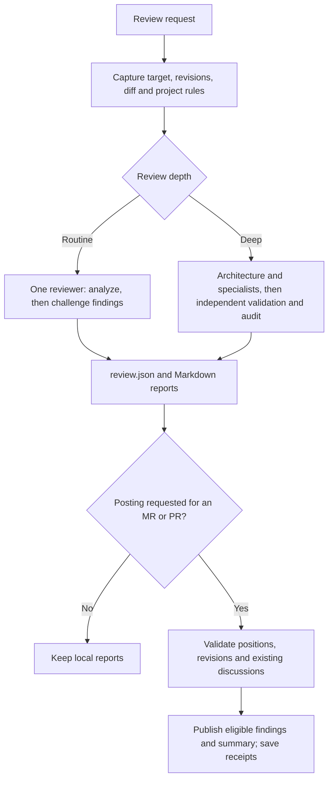

# dotai-review

Two review processes share one finding contract and one publisher with GitLab and GitHub adapters:

| Mode | Process | Destination |
| --- | --- | --- |
| Routine | One reviewer, followed by a deliberate verification pass | Local Markdown, GitLab or GitHub |
| Deep | Architecture, independent specialists, validation, severity audit | Local Markdown, GitLab or GitHub |

The source is this directory. `scripts/install.sh` publishes it as `code.review-workflow` for the repo's supported tools; the same directory is a Claude Code plugin. There are no generated copies, external plugin dependencies, bundled server configuration, or CI workflows.

## Design and process

Depth and destination are separate choices. Both modes produce the same structured
report; either can publish to GitLab or GitHub when the user requests it.



See [the design walkthrough](references/design.md) for separate routine and deep
process graphs, context passed to each worker, publication safeguards, and the
differences from Bitwarden. These graphs describe agent instructions and the Python
publisher: the helper does not itself launch agents or enforce their independence.

## Use as a skill

From the dotai checkout, run `bash scripts/install.sh`. Start a new agent session and ask:

```text
Use review-workflow for a routine review of my pending changes. Keep the report local.

Use review-workflow for a deep review of HEAD~5..HEAD.

Use review-workflow to review https://gitlab.example.com/team/app/-/merge_requests/42
and post validated findings to that MR.

Use review-workflow for a deep review of https://github.com/owner/repo/pull/42
and post validated findings to that PR.
```

An MR/PR URL alone does not select publication. Both modes can publish when asked. Deep reports retain rejected findings locally; only verified findings reach the requested MR/PR. The assessment is a comment, not a provider approval or merge action.

## Use as a Claude Code plugin

Load the local package:

```bash
claude --plugin-dir ./skills/code/review-workflow
```

Or register this repository as a marketplace in Claude Code:

```text
/plugin marketplace add /absolute/path/to/dotai
/plugin install dotai-review@dotai
```

The repository marketplace can be installed from `NoSugarCoffee/dotai` once this change is published there. Available commands:

```text
/dotai-review:review local changes
/dotai-review:deep-review HEAD~5..HEAD
/dotai-review:review https://gitlab.example.com/team/app/-/merge_requests/42 post to GitLab
/dotai-review:review https://github.com/owner/repo/pull/42 post to GitHub
```

`/dotai-review:review-workflow` is the shared core entry. Prefer either the portable skill or plugin entry for a given invocation; both run the same rules. Plugin agents have read-only tools and return findings to the orchestrator, which alone can publish.

## GitLab and GitHub integration

The helper requires Python 3.9+ and the authenticated CLI for the selected provider:

| Provider | CLI | Capture and publication |
| --- | --- | --- |
| GitLab | `idev-cli` | [GitLab adapter](references/gitlab.md) |
| GitHub | `gh` | [GitHub adapter](references/github.md) |

Credentials remain managed by the CLI. Install programs through the machine's normal tooling, not this repository. If an asdf shim says no Node version is selected, use the machine's configured Node version or a task-local `ASDF_NODEJS_VERSION` setting; this error is unrelated to GitLab authentication.

The helper offers `snapshot`, `render`, and `publish`; use `--help` for arguments. `publish` defaults to a read-only plan; `--apply` executes it. Keep the output directory and `publication.json` for subsequent reviews of the same MR/PR. See [shared publication process](references/publishing.md) for revision checks, ownership, partial failures and recovery.

The three outputs are `review-summary.md`, `review-inline-comments.md`, and `review-report.md`. See [finding contract](references/findings.md) for the JSON input. Routine review uses a 75 confidence screen; deep review uses 80 plus independent validation and severity audit. These are initial policy settings, not calibrated probabilities.

## Verify

```bash
python3 -m unittest discover -s skills/code/review-workflow/tests -v
claude plugin validate skills/code/review-workflow
claude plugin validate .claude-plugin/marketplace.json
bash scripts/install.sh --list
bash scripts/verify-skills-layout.sh
```

The offline tests exercise added/deleted/renamed lines, pagination, stale revisions, duplicate publication, ownership, human replies, partial failure, and incomplete verdicts. They perform no network calls or remote writes. Behavior scenarios are in [evals/evals.json](evals/evals.json); no real MR/PR is needed to run them.

## Design sources

This implementation is independently written, informed by the two review paths in [Bitwarden's plugin](https://github.com/bitwarden/ai-plugins/tree/main/plugins/bitwarden-code-review). It uses this project's own severity rules, runtime conventions and provider adapters. Useful technical references are [GitLab diff discussions](https://docs.gitlab.com/api/discussions/#create-a-new-thread-in-the-merge-request-diff) and [Claude plugin manifests](https://code.claude.com/docs/en/plugins-reference). Bitwarden's organizational standards and vault threat model are not dependencies.
