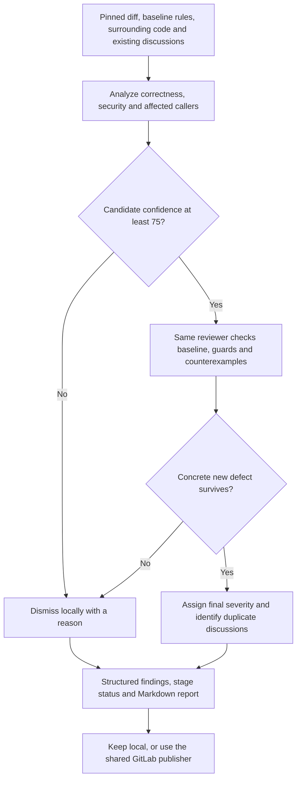
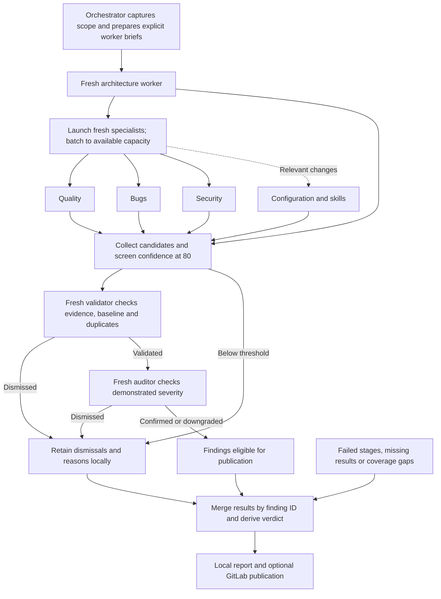
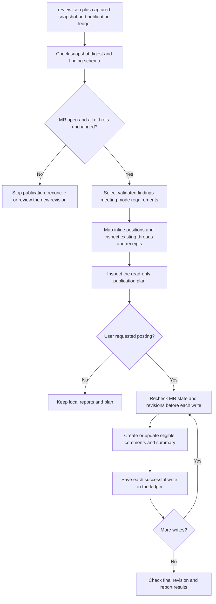

# Review design

The workflow separates three responsibilities: the runtime schedules reviewers,
reviewers return evidence, and the Python helper validates reports and publishes
comments. Codex and Claude Code use the same process references and finding
contract. Claude plugin agent definitions provide reusable role prompts; separate
invocations provide the independent workers required by deep mode.

This document explains the existing design. The execution rules remain in
[scope](scope.md), [routine](routine.md), [deep](deep.md),
[findings](findings.md), and [GitLab publishing](gitlab.md).

## Routine: one reviewer with a second verification pass

The verification pass tries to disprove each candidate. It is a second pass by the
same reviewer, not an independent opinion. `audit: not_run` records that distinction.
An empty finding list is valid; a failed stage is recorded as incomplete.

In Claude Code the orchestrator delegates to `routine-reviewer`. A portable runtime
can perform this process in the current agent or use one read-only worker. The
orchestrator handles report files and publication.

## Deep: separate analysis, validation and severity decisions

Architecture runs before the specialist phase. Quality, bugs and security use
separate workers; limited runtime capacity changes scheduling, not worker identity.
Validation challenges whether a defect exists. The severity audit then challenges
its impact. The original evidence, severity and confidence stay in the record when
a later stage dismisses or downgrades a finding.

Every worker receives the pinned scope, project rules, source access, its role,
the finding contract and read-only boundaries. Additional context is deliberate:

| Worker | Feature intent and ticket context | Responsibility |
| --- | --- | --- |
| Architecture | Included | Contracts, boundaries, state ownership and migrations |
| Quality | Withheld | Inconsistencies and maintenance defects with concrete consequences |
| Bugs | Withheld | Failing execution paths, edge cases and regressions |
| Security | Included | Trust boundaries, authorization and sensitive data |
| Configuration/skills | Scoped to relevant changes | Permissions, instructions and runnable references |
| Validation | Included, with candidates | Disprove findings and eliminate duplicates |
| Severity audit | Validated evidence and impact | Confirm, downgrade or dismiss |

Withholding product framing from quality and bugs reduces anchoring on the intended
behavior. They can still inspect surrounding code. Security and architecture need
intent to check whether the proposed behavior satisfies the actual requirements.

A validator discovering a different defect returns a new candidate for validation
before audit. Large candidate sets are validated in groups; related findings stay
together. Missing responses are stage failures, not evidence that no defect exists.

## Shared publication path

Only the orchestrator publishes. The helper handles GitLab transport through
`idev-cli`; reviewer workers do not hold publication tools. The user authorizes
posting through the request, so inspecting the plan is not another permission gate.

Matching existing discussions suppress duplicate findings. Ledger receipts allow
updates only to recorded comments with the expected author and marker. Resolved
threads and threads with another author's reply are preserved. A partial failure
leaves successful receipts available for reconciliation; publication is not atomic.

## Verdicts and failure behavior

| Condition | Report assessment | Remote behavior when posting was requested |
| --- | --- | --- |
| No usable review scope | NO VERDICT | Summary explains why no review was possible |
| Failed stages, missing coverage or unverified candidates | INCOMPLETE | Only individually eligible findings can post; summary exposes gaps |
| Complete review with an important or blocker finding | REQUEST CHANGES | Publish eligible findings and summary |
| Complete review with suggestions or no findings | APPROVE | Publish eligible suggestions and summary |

These are report labels. They do not call GitLab approve, merge or resolve operations.
Deep findings need completed validation and severity audit to become publishable.
Rejected candidates remain in the local report, so their evidence and dismissal
reasons are available for inspection.

## What comes from Bitwarden, and what differs

[Bitwarden's overview](https://github.com/bitwarden/ai-plugins/blob/main/plugins/bitwarden-code-review/README.md)
describes separate routine and multi-agent review paths. Our adaptation retains
the separation of analysis, validation and severity audit, explicit worker briefs,
different context for specialists, confidence screening, and retained dismissals.

| Design choice | Bitwarden | dotai-review |
| --- | --- | --- |
| Output | Routine supports GitHub comments; deep writes local reports | Both depths support local reports or explicitly requested GitLab comments |
| Product policy | Bitwarden security plugin and vault threat model | Reviewed project's baseline rules and actual trust boundaries |
| Runtime and models | Claude-specific agents and model selection | Session model by default; runtime-specific worker scheduling |
| Finding classification | Five severity categories | Blocker, important and suggestion; confidence remains separate |
| Publication | GitHub tools and comment conventions | Python adapter, GitLab diff positions and publication receipts |

The upstream [routine agent](https://github.com/bitwarden/ai-plugins/blob/main/plugins/bitwarden-code-review/agents/bitwarden-code-reviewer/AGENT.md)
and [deep skill](https://github.com/bitwarden/ai-plugins/blob/main/plugins/bitwarden-code-review/skills/performing-multi-agent-code-review/SKILL.md)
contain additional company-specific instructions. This package is an adaptation,
not a complete port of every upstream policy or integration.

## What is enforced, and what still needs evaluation

The helper validates schema, reported stage completion, confidence and audit
eligibility, snapshot identity, diff positions, and publication ownership. It cannot
prove that an agent inspected the code or that workers were independent. Scheduling,
context isolation and evidence quality depend on the runtime following the skill.

Routine review and GitLab publication have been exercised on an authorized live MR.
Offline helper tests cover publication and report failure cases; small behavior
fixtures cover routine analysis and incomplete deep reports. The full deep pipeline
has not yet been exercised end to end on a live MR. No CI trigger or standalone
agent scheduler is included.
